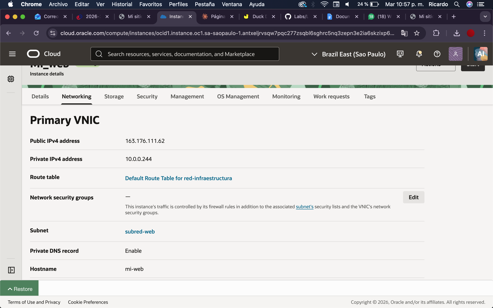
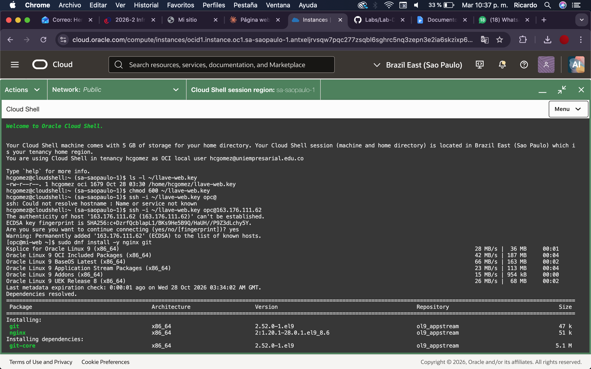
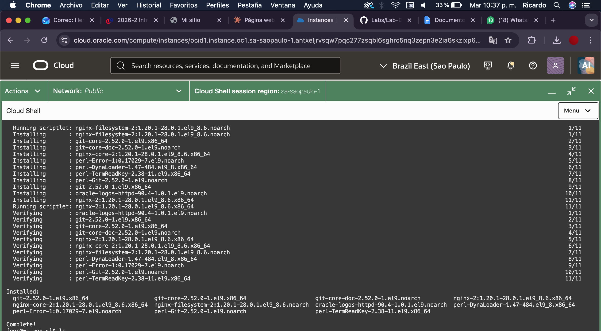
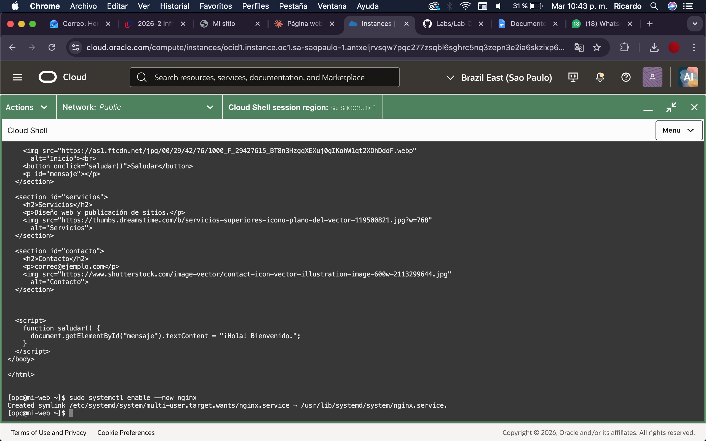
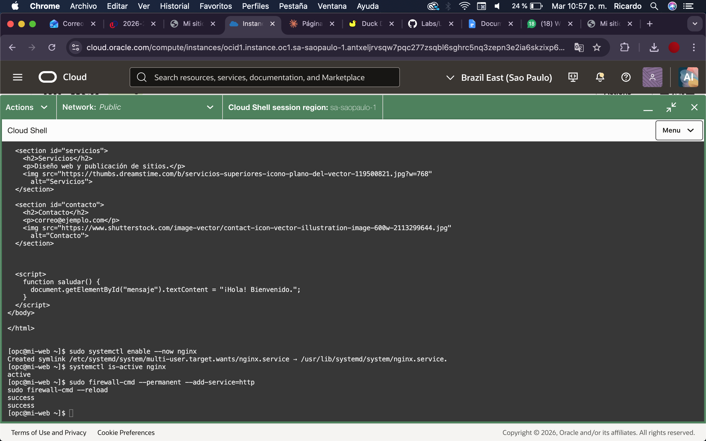
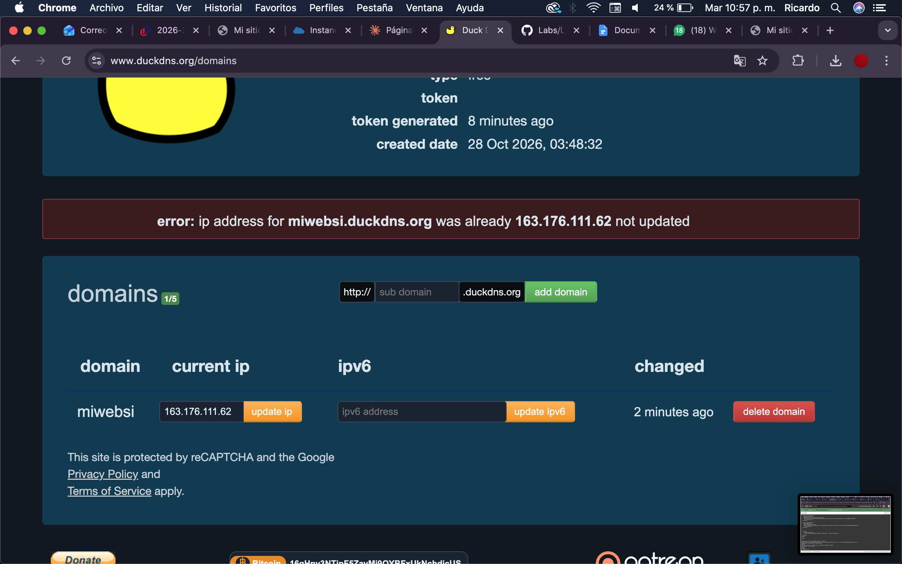
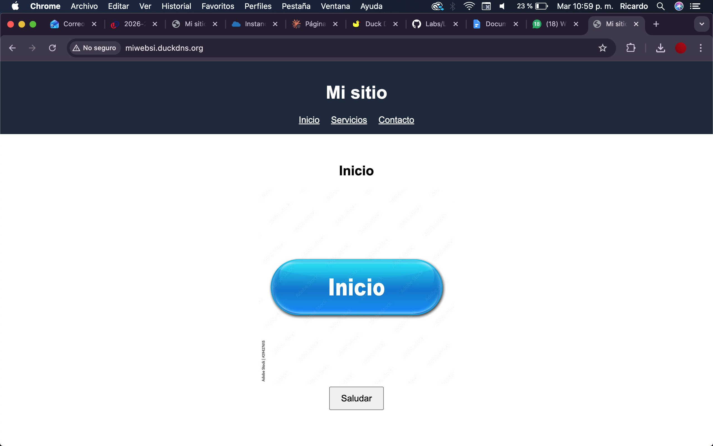

**Sitio publicado:** http://miwebsi.duckdns.org

---

## 1. Crear la máquina virtual

1. En la consola de OCI: **Compute → Instances → Create instance**.
2. Nombre: `mi-web`. Imagen: Oracle Linux 9.
3. Red: reutilizar la VCN `red-infraestructura` y la subred pública `subred-web`, con IP pública asignada.
4. Cargar o generar la llave SSH (se guardó como `llave-web.key`) y pulsar **Create**.


Datos de red de la instancia una vez creada (IP pública, IP privada, subred y hostname):



---

## 2. Conectarse a la VM por SSH desde Cloud Shell

1. Abrir **Cloud Shell** en la consola de OCI.
2. Subir la llave privada (menú **Upload**) y ajustar permisos:
   ```bash
   chmod 600 ~/llave-web.key
   ```
3. Conectarse (usuario `opc` en Oracle Linux):
   ```bash
   ssh -i ~/llave-web.key opc@163.176.111.62
   ```
4. Responder `yes` al aviso de autenticidad del host.

---

## 3. Instalar Nginx

```bash
sudo dnf install -y nginx git
```





---
## 4. Iniciar Nginx y abrir el puerto 80 en la VM

1. Habilitar e iniciar el servicio:
   ```bash
   sudo systemctl enable --now nginx
   ```

   

2. Verificar el estado y abrir HTTP en el firewall:
   ```bash
   systemctl is-active nginx
   sudo firewall-cmd --permanent --add-service=http
   sudo firewall-cmd --reload
   ```

   

---


## 7. Probar la página con la IP pública

Abrir en el navegador `http://163.176.111.62`.


---

## 8. Configurar el subdominio de DuckDNS

1. Iniciar sesión en [duckdns.org](https://www.duckdns.org).
2. En **sub domain** escribir `miwebsi` y pulsar **add domain**.
3. En el campo **current ip** poner la IP pública de la instancia (`163.176.111.62`) y pulsar **update ip**.
4. Resultado: `miwebsi.duckdns.org` apunta a la VM.



---

## 9. Comprobación desde un navegador externo a la VM

Desde un celular con datos móviles (fuera de la red de la VM) abrir:

```
http://miwebsi.duckdns.org
```



---

## Resultado

- Sitio web: http://miwebsi.duckdns.org
